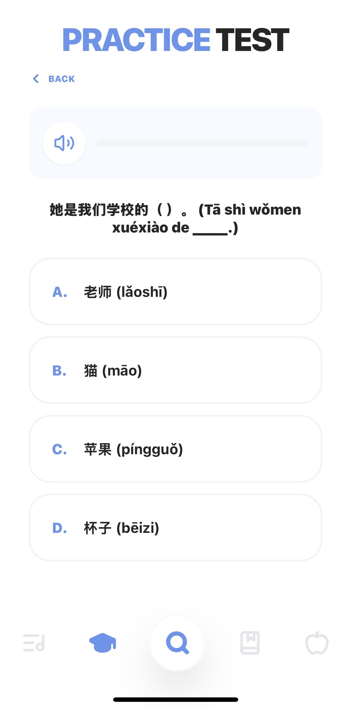
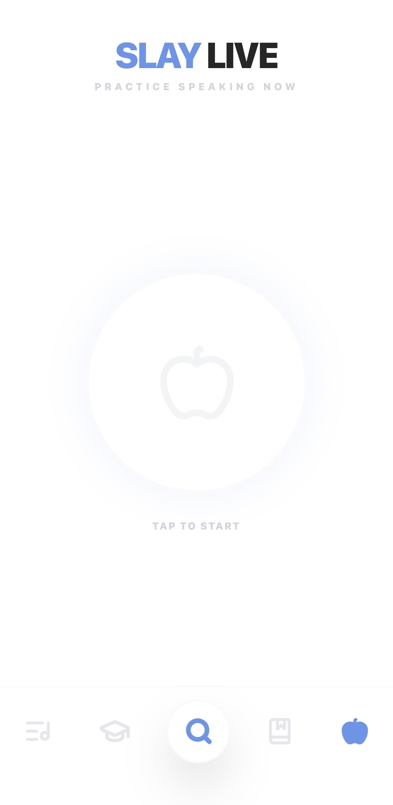

# Slay Mandarin

A Mandarin-learning app built around cultural interests and everyday use, using Google AI Studio and Cursor for AI-assisted development.

## User problem and my contribution

The project began with a learner who wanted to connect through Chinese culture and music. Entering Chinese song titles was difficult, so I added screenshot input as an alternative to typing a title. I defined and iterated on the features and learning experience, used AI Studio to generate and revise the implementation, and used Cursor for build and deployment work. The app was previously deployed to Cloudflare as a progressive web app.

The code in this folder comes from my saved `slay-mandarin-update` project. It is a recovered local source snapshot; the exact match to the final deployed version has not been established.

## Features visible in the source

- Screenshot-based song lookup using image input, followed by Gemini search grounding.
- Dictionary explanations with pinyin, cultural context, and usage examples.
- Generated HSK-style practice questions using structured JSON output.
- Voice conversation through the Gemini Live API and audio playback through Web Audio.
- Gemini text-to-speech with a browser speech-synthesis fallback.
- Browser `localStorage` for saved vocabulary, mistakes, and songs.
- Web app manifest and service-worker code from the prototype.

The use of search grounding and structured outputs describes the implementation. It does not establish that every response is correct, that practice questions meet an official standard, or that the app improves learning outcomes.

## Screenshots from the original app

 

Dictionary explanations and a practice-question interface. These screenshots document the original app; they are not new outputs generated during repository preparation.

 

Song lookup with screenshot input, and the voice-practice start screen. The voice screenshot shows the interface rather than proving an active conversation.

## Inspect and run locally

The Gemini features are currently inactive following API-key deactivation. No credential is included. You can inspect the source and open the interface without reactivating the original key.

```sh
npm ci
npm run dev
```

Vite prints the local URL. To check a production bundle locally:

```sh
npm run build
npm run preview
```

For optional local API experimentation, copy `.env.example` to `.env.local` and supply your own key. **This recovered prototype calls Gemini from the browser, and Vite embeds a configured key in the browser bundle.** Environment-variable configuration removes credentials from source control; it does not make a public client bundle secret. Public live hosting would require suitable server-side credential handling, and the Live API would need an appropriate client-authentication approach. See [Google's API-key guidance](https://ai.google.dev/gemini-api/docs/api-key).

Without a key, the source's shared client helper stops Gemini requests. AI search, generation, and conversation will not return new results. Historical model names have been retained and may need updating before live use. UI styling uses the original Tailwind CDN and Google Fonts, so this is not a fully offline demo.

## Scope and limitations

The original embedded video-feed examples, exam archives, and recordings are omitted from this portfolio. `public/feed.json` is an empty list. Static PWA assets are placed under Vite's `public/` folder for bundling. The existing service worker is preserved; offline caching and installability have not been validated.

The source and screenshots show an individual AI-assisted prototype. No production-scale reliability, user-adoption count, or measured learning benefit is claimed. See [preparation notes](../PREPARATION.md) for the local checks and sharing edits.
